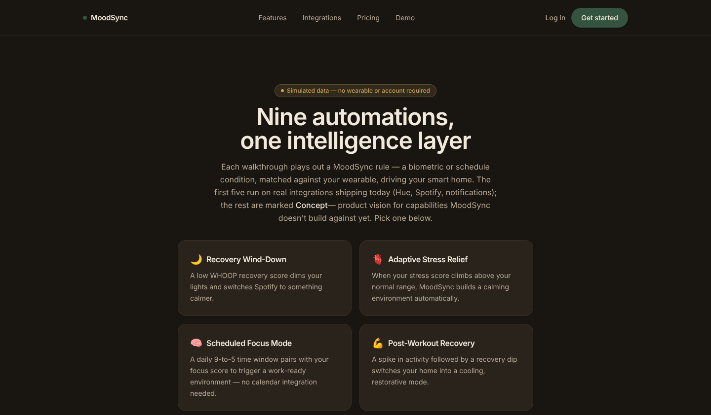
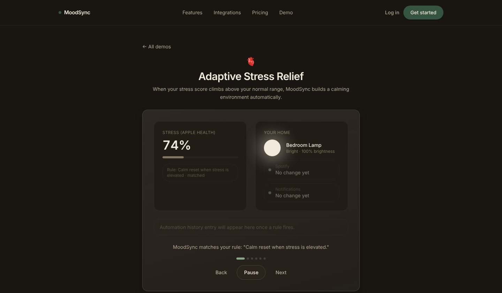

# MoodSync

MoodSync connects a person's wearable health data to the smart home they
already own. It reads biometric signals such as recovery, sleep and heart
rate, decides what the environment should do about them, and either
recommends or triggers the change: lights, music, notifications and more.
It does not make hardware.

[](https://github.com/anaygoyal7878-del/moodsync/actions/workflows/ci.yml)

## Demo

The web app includes a demo that runs on simulated data, so no wearable or
account is needed. Run `npm run dev:frontend` and open `/demo`.





## What it does

- **Reads the body.** Pulls recovery, sleep and workout data from wearables
  (WHOOP and Google Health/Fitbit are wired up) and normalizes it into one
  typed reading per day.
- **Decides what to do.** A decision engine evaluates user rules and wellness
  scores against each reading, resolves conflicts between automations,
  applies rate limits and safety bounds, and logs a plain language reason for
  every action it takes.
- **Changes the environment.** Executes actions through Philips Hue and
  Spotify, with a pluggable action executor registry for adding more.
- **Talks like a person.** Clara, the assistant, works over text messages and
  can read your data and take real actions through tools.
- **Explains itself.** Weekly reports, persisted insights and recommendations
  show why the system behaved the way it did.

## Engineering highlights

- **Security by default.** Passwords use argon2id. Sessions use short lived
  JWT access tokens with rotating, hashed, revocable refresh tokens. Third
  party OAuth tokens are encrypted at rest with AES-256-GCM, and the key never
  touches the database.
- **Honest integrations.** Each provider package reports a real
  `IntegrationStatus` based on researched API access, not wishful thinking.
  See `docs/INTEGRATIONS_RESEARCH.md` for what is actually available and why
  Alexa and Ecobee are limited.
- **Tested.** 79 TypeScript test files sit next to the code they cover, and
  the Swift companion package has its own tests.
- **CI on every push.** GitHub Actions runs typecheck, lint, tests and build
  on Node 22.
- **Documented decisions.** `docs/` holds 44 architecture and research
  documents, and `docs/MILESTONES.md` tracks 17 milestones built one at a
  time, tested before moving on.

## Tech stack

| Layer | Tools |
|---|---|
| Web app | Next.js 16, React 19, Tailwind CSS 4, Recharts |
| API | Fastify 5, Zod validation, pino logging, rate limiting |
| Data | PostgreSQL with Prisma |
| Auth | argon2id, JWT via `jose`, rotating refresh tokens |
| Decision engine | TypeScript, framework agnostic, unit tested |
| Mobile | Swift package and iOS companion app |
| Other | Supabase Edge Functions, Railway deploy configs, Vitest |

## Repository layout

This is an npm workspaces monorepo.

```
frontend/       Next.js web app (marketing site and dashboard)
backend/        Fastify API server (auth, REST API, orchestration)
shared/         Types and utilities used by every workspace
database/       Prisma schema, migrations and seed data
ai/             Decision engine: biometric signals to recommended automations
integrations/   One typed OAuth and API client package per external platform
workers/        Background jobs (data sync, decision runs), scaled separately
ios/            Swift companion package and iOS app
Packages/       Swift package with core MoodSync logic
supabase/       Supabase Edge Functions
web/            Earlier React prototype for scent and diffuser recommendations
docs/           Architecture, research and milestone documentation
scripts/        Dev and ops scripts
```

`integrations/` and `workers/` are top level packages instead of folders
inside `backend/` because the API and the workers share the same platform
clients, and a slow sync job should never compete with an inbound request.
Keeping them separate makes scaling a deployment choice, not a refactor.

## Getting started

Requires Node 20 or newer and a reachable PostgreSQL database.

```
npm install
cp .env.example .env     # then set DATABASE_URL and the secrets
npm run db:generate
npm run db:migrate
npm run dev:backend
npm run dev:frontend
```

Other useful commands: `npm run typecheck`, `npm run lint`, `npm test`,
`npm run build`.

If you have no local Postgres, the `embedded-postgres` npm package can run a
real Postgres binary as a subprocess. `docs/MILESTONES.md` describes how it
was used to verify the full signup, login, session and logout flow against a
genuine database.

## Where to read next

- `docs/MILESTONES.md` for the build plan and current status
- `docs/DECISION_ENGINE_ARCHITECTURE.md` for how decisions are made
- `docs/CLARA_ARCHITECTURE.md` for the messaging assistant
- `docs/INTEGRATIONS_RESEARCH.md` for the verified state of every third party API

## License

MIT. See [LICENSE](LICENSE).
